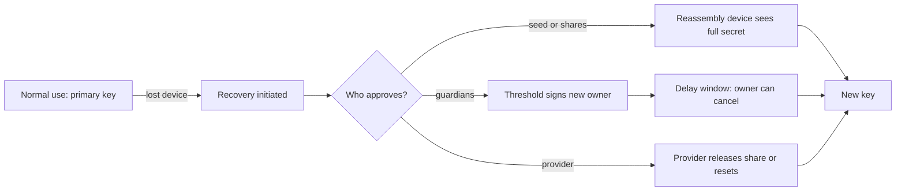

# The Recovery Threat Model

Every wallet faces two opposite failures: the owner loses access, or someone else gains it. Recovery mechanisms fix the first by creating a second way in. That second way in is, by definition, a path to the funds that does not require the owner's primary key. If an attacker can use it, recovery becomes the attack. This chapter frames recovery mechanisms and the threats against them.

## Loss versus theft

Studies of user behaviour and the volume of support requests at wallet providers point the same way: ordinary users lose keys far more often than they are hacked. A design that makes theft impossible but loss likely is not secure in practice; it moves the failure from attacker to accident. Good recovery design accepts both risks and puts explicit numbers or rankings on them.

| Mechanism | Protects against loss | New theft surface |
|---|---|---|
| Seed phrase (BIP 39) | device loss | anyone who sees or photographs the phrase |
| Shamir backup (SLIP-39) | loss of some shares | collecting a threshold of shares; reassembly device |
| Multisig with backup key | loss of one key | backup key storage |
| Guardian social recovery | loss of the owner key | guardian collusion, guardian compromise, phishing guardians |
| Cloud-encrypted backup | device loss | cloud account takeover plus password guessing |
| MPC with recovery share | loss of one share | recovery share holder, provider compromise |
| Custodial reset (email/SMS/KYC) | everything | SIM swap, email takeover, support social engineering |

## Assets and actors

The asset is not only the key but **the right to replace the key**. Recovery paths change who owns the account. Actors who want that right:

- **Remote phishers** who impersonate wallet support, "validation" sites, or airdrops to collect seed phrases.
- **SIM swappers and email takeover crews** who reset factors that custodial or semi-custodial recovery relies on.
- **Guardians** who collude, are coerced, or are themselves compromised.
- **Providers** whose servers, insiders or legal obligations can expose recovery data.
- **Physical attackers** with access to a home, safe, or deceased owner's papers.
- **Malware** on the device used during recovery, which sees the secret at its most exposed moment.

## When the secret is most exposed

Recovery events are rare and stressful, so users follow instructions from whoever seems helpful. The device that reassembles shares or types the seed has the whole secret in memory. A good mental model is that recovery is a planned key compromise: design it so that the moment is short, on a trusted device, and verified.



## Design properties

When you evaluate any recovery scheme, ask:

1. **Threshold:** how many independent parties or secrets are needed?
2. **Independence:** can one event (cloud account takeover, a burglary, one phishing site) satisfy the threshold?
3. **Delay and cancellation:** is there a window during which the legitimate owner is notified and can stop it?
4. **Notification:** does the owner learn about recovery attempts on a channel the attacker does not control?
5. **Verifiability:** can the owner test the backup without exposing it?
6. **Rotation:** can guardians, shares and passwords be replaced without moving funds?

The remaining chapters apply these questions to each mechanism. The sibling books **account-abstraction-security** and **mpc-wallet-security** cover the underlying account and threshold-signature machinery.

## Ethics and scope

Recovery attacks target people. Run experiments only with test keys, testnets and accounts you own. Never request or handle someone's real seed phrase, even to help.

## Worked example

> **Execution status:** not executed in this book's CI. Commands, code and expected results below are written from documentation, not observed output; verify locally.

Generate and verify a BIP 39 mnemonic offline, and see why a passphrase changes the threat model.

1. On an offline machine or a disposable VM, install the reference library and generate a phrase:

```bash
python3 -m venv v && . v/bin/activate
pip install mnemonic
python3 - <<'EOF'
from mnemonic import Mnemonic
m = Mnemonic("english")
words = m.generate(strength=128)
print(words)
print("valid:", m.check(words))
seed_a = m.to_seed(words, passphrase="")
seed_b = m.to_seed(words, passphrase="correct horse")
print(seed_a.hex()[:32], seed_b.hex()[:32])
EOF
```

2. Change one word and run `m.check()` again. The checksum usually fails, which catches most single-word typos but is not error correction.
3. Note that the two seeds differ completely. Someone who finds the written words but not the passphrase derives a different, empty wallet.
4. Record the trade-off: a passphrase adds a factor against theft but adds a new thing to lose. Fill in the loss and theft columns of the table above for "phrase + passphrase".

## Common pitfalls

- Optimising only against theft and creating designs ordinary users will lose.
- Treating recovery as a rare edge case rather than an attack surface.
- Letting a single account (email, cloud, phone number) satisfy the whole recovery threshold.
- Generating or typing seeds on internet-connected everyday devices.
- No notification when recovery starts.

## Exercises

1. Pick three wallets you know and fill in the loss/theft table for their recovery mechanisms, citing their documentation.
2. For each, identify the single event that could satisfy the recovery threshold, if any.
3. Extend the Python example to derive the first Ethereum or Bitcoin address from the seed with a BIP 32 library, and confirm it matches a wallet imported with the same phrase on a testnet.

## Further reading

- BIP 39, Mnemonic code for generating deterministic keys: <https://github.com/bitcoin/bips/blob/master/bip-0039.mediawiki>
- Vitalik Buterin, "Why we need wide adoption of social recovery wallets" (2021): <https://vitalik.eth.limo/general/2021/01/11/recovery.html>
- python-mnemonic: <https://github.com/trezor/python-mnemonic>
- See **account-abstraction-security** and **mpc-wallet-security**
