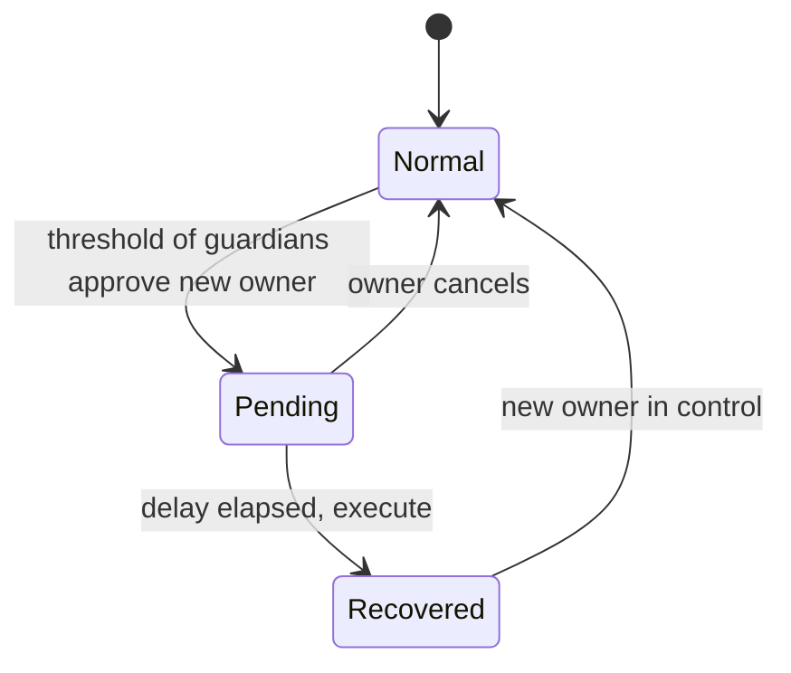

# Guardian-Based Social Recovery in Smart Accounts

Smart contract accounts can change their own signing key. Social recovery uses that ability: a set of guardians can, together, replace the owner key after a delay. Vitalik Buterin's 2021 essay made the case for wide adoption, and wallets such as Argent shipped guardian recovery years earlier. This chapter covers how guardian recovery works and how to build it safely.

## The basic protocol

1. The owner configures a guardian set and a threshold, for example 3 of 5.
2. If the owner loses their key, they ask guardians to approve a new owner address.
3. Once the threshold approves, a recovery is **pending** for a delay (days, typically).
4. During the delay, the current owner key can cancel. Notifications go out.
5. After the delay, anyone executes the recovery and the owner changes.



## Choosing guardians

| Guardian type | Strength | Weakness |
|---|---|---|
| Friends and family (EOAs or their own smart accounts) | independent people, hard to phish all at once | may lose their own keys; may know each other and collude |
| Owner's other devices | convenient | same person, same phishing, same burglary |
| Hardware wallet in a safe | strong | physical access |
| Institutional guardian service | available, verifies identity | single provider; insider and legal risk |
| Email or phone based guardian (via a service) | familiar | inherits SIM swap and email takeover risk |

Good practice: a threshold that no single person or service can meet, guardians who do not all know each other, and a mix of types. Some designs store only a hash of guardian addresses on-chain so guardians are not publicly identifiable until recovery.

## Security properties to enforce in code

- **Guardian changes are delayed** like recovery itself. Otherwise an attacker with the owner key adds their own guardians, and a thief with a stolen owner key cannot be stopped later by real guardians.
- **Recovery approvals are bound** to a specific new owner, account, chain and nonce. Signatures reused across accounts or chains are a classic bug.
- **Cancellation** is available to the current owner, and optionally to a guardian threshold, during the delay.
- **One pending recovery at a time,** with a clear rule for replacement.
- **Execution checks** the delay with block timestamps and clears pending state.
- **Events** for every step, so off-chain notifiers can alert the owner.

Implementations to study include Argent's contracts, Candide's social recovery module for Safe, and ERC-7579-compatible recovery modules. Modules in modular accounts are themselves high-privilege code; see **account-abstraction-security**.

## The compromised-owner problem

Guardian recovery handles a *lost* key well. A *stolen* key is harder: the thief holds the same key as the owner and can cancel the guardians' recovery, or simply drain funds before guardians act. Mitigations:

- Spending limits and delays for large transfers, so a thief cannot drain instantly.
- Allowing a guardian threshold to **freeze** or **lock** the account, which the owner key alone cannot undo during the lock.
- Letting a guardian supermajority override an owner cancellation.

Each mitigation gives guardians more power, which raises the stakes of guardian compromise. Write down which party wins each race.

## Worked example

> **Execution status:** not executed in this book's CI. Commands, code and expected results below are written from documentation, not observed output; verify locally.

Build and test a minimal guardian recovery in Foundry. This is a teaching contract, not a production wallet.

```solidity
pragma solidity ^0.8.24;
contract RecoverableAccount {
    address public owner;
    mapping(address => bool) public isGuardian;
    uint256 public threshold;
    uint256 public constant DELAY = 3 days;
    address public pendingOwner;
    uint256 public pendingSince;
    uint256 public nonce;
    mapping(uint256 => mapping(address => bool)) public approved;
    uint256 public approvals;

    constructor(address o, address[] memory g, uint256 t) {
        owner = o; threshold = t;
        for (uint i; i < g.length; i++) isGuardian[g[i]] = true;
    }
    function approveRecovery(address newOwner) external {
        require(isGuardian[msg.sender], "not guardian");
        if (pendingOwner != newOwner) { pendingOwner = newOwner; approvals = 0; nonce++; pendingSince = 0; }
        require(!approved[nonce][msg.sender], "dup");
        approved[nonce][msg.sender] = true;
        if (++approvals == threshold) pendingSince = block.timestamp;
    }
    function cancel() external {
        require(msg.sender == owner, "not owner");
        pendingOwner = address(0); pendingSince = 0; approvals = 0; nonce++;
    }
    function execute() external {
        require(pendingSince != 0 && block.timestamp >= pendingSince + DELAY, "not ready");
        owner = pendingOwner; pendingOwner = address(0); pendingSince = 0; approvals = 0; nonce++;
    }
}
```

1. `forge init recovery-lab`, add the contract, and write tests:
   - two of three guardians approve, `execute` before 3 days reverts, after `vm.warp(block.timestamp + 3 days)` it succeeds;
   - the owner cancels during the delay and `execute` reverts;
   - one guardian approving twice reverts.
2. Find the weakness: a single malicious guardian can call `approveRecovery` with a different address and reset everyone's approvals. Write a test that shows this griefing, then fix it (for example, require the pending recovery to be cancelled or expired before a new target is accepted).
3. Run `forge test -vv` and keep the failing-then-passing tests as evidence.

## Common pitfalls

- Guardian set changes with no delay.
- Approvals not bound to account, chain and nonce.
- All guardians being the owner's own devices.
- Ignoring griefing: a single guardian repeatedly starting or resetting recovery.
- No off-chain notification on recovery events.
- Assuming guardian recovery helps when the owner key is stolen rather than lost.

## Exercises

1. Add a guardian-change function with its own delay and cancellation, and test that an attacker with the owner key cannot add guardians instantly.
2. Add a guardian-threshold "lock" that blocks owner transfers for 7 days, and write a test of the stolen-key race.
3. Deploy the contract to a local Anvil node and write a script that watches recovery events and prints an alert.

## Further reading

- Vitalik Buterin, "Why we need wide adoption of social recovery wallets" (2021): <https://vitalik.eth.limo/general/2021/01/11/recovery.html>
- Argent contracts: <https://github.com/argentlabs/argent-contracts>
- ERC-7579 modular accounts: <https://eips.ethereum.org/EIPS/eip-7579>
- Foundry book: <https://book.getfoundry.sh>
- See **account-abstraction-security**
