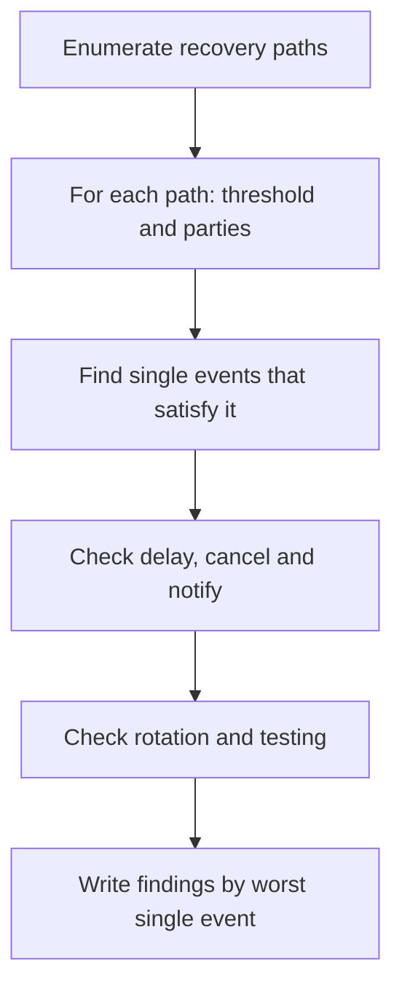

# Recovery Design Review Checklist

This chapter is a checklist for reviewing a wallet's recovery design, whether you are building one or assessing a product. It follows the properties from chapter 1: threshold, independence, delay, notification, verifiability and rotation. Test only with your own test accounts on testnets or local chains, and report weaknesses privately to the vendor.

## Step 1: enumerate every path to a new key

List every way the account's controlling key can change or be used without the current primary device. Include the ones vendors forget:

- seed phrase or Shamir shares;
- guardians or recovery modules;
- cloud backup;
- provider-assisted recovery (support tickets, KYC, video calls);
- MPC share refresh flows;
- admin or upgrade keys on the smart account implementation;
- session keys and delegated permissions that survive recovery.

## Step 2: threshold and independence

For each path, write the parties and the minimum set that suffices. Then look for **correlated** parties.

| Correlation | Example |
|---|---|
| Same account | cloud backup and email reset both in one Google account |
| Same phone number | SMS factor and messaging-app guardian |
| Same household | two Shamir shares in the same house |
| Same provider | MPC provider share and provider-run guardian |
| Same person | guardians that are all the owner's own devices |

A path whose threshold can be met by a single correlated event is effectively single-factor.

## Step 3: delay, cancellation, notification

- Is there a delay before recovery takes effect? How long?
- Who can cancel? What happens if owner key and guardians disagree?
- Do guardian, recovery-address and notification-setting changes have their own delays?
- Are notifications sent to multiple channels configured before the recovery started?
- Can a single party grief recovery indefinitely?

## Step 4: implementation checks (smart accounts)

- Approvals bound to account, chain ID, nonce and new owner.
- Signature verification handles both EOA and ERC-1271 contract guardians.
- One pending recovery; clear replacement rules.
- Events for every state change.
- Module installation and removal delayed and evented.
- Recovery clears or re-validates session keys and other delegated permissions.
- Tests cover the race scenarios from chapter 4.

## Step 5: backups and secrets

- BIP 39 or SLIP-39 used correctly; no home-made word splitting.
- KDF parameters for encrypted backups measured and documented.
- Reassembly happens on a trusted device.
- Users can test backups without exposing them.
- Seed phrases are never entered into web pages.

## Step 6: people and support

- Support staff have a script that never asks for seeds or shares and explains how to recognise impersonators.
- Identity verification for provider-assisted recovery resists SIM swap and deepfaked video; use multiple factors established long before.
- Users are prompted to review guardians and backups periodically.
- Inheritance is addressed explicitly.

## Rating findings

| Severity | Rule of thumb |
|---|---|
| Critical | a single remote event (one phishing page, one account takeover) moves funds |
| High | a single event moves funds after a delay with no effective notification, or one insider suffices |
| Medium | two independent events required but correlation is likely |
| Low | usability or documentation gaps that lead to loss rather than theft |

## Worked example

> **Execution status:** not executed in this book's CI. Commands, code and expected results below are written from documentation, not observed output; verify locally.

Review the Foundry contract from chapters 3 and 4 against this checklist and produce findings with tests as evidence.

1. Enumerate paths: owner key; guardian threshold plus delay. No guardian-change function exists, so guardian set rotation is impossible: record as a finding (liveness).
2. Check binding: approvals are bound to the contract implicitly (msg.sender on this contract), but not to chain ID. On a single deployment that is fine; if the same contract is deployed on several chains with off-chain signed approvals, they must include chain ID. Add a note.
3. Check delays and cancel: owner-only cancel. Run `test_stolenKeyBlocksRecovery` from chapter 4 as evidence that a stolen key blocks recovery forever (High).
4. Check events: none are emitted. Add `RecoveryApproved`, `RecoveryCancelled`, `RecoveryExecuted`, then write a test using `vm.expectEmit` (Medium: no notification possible without events).
5. Write the report: each finding has a title, severity, test name, and fix. If an LLM drafts the report text, rerun every referenced test and confirm each claim before sharing.

## Common pitfalls

- Reviewing only the documented recovery path and missing support-assisted or upgrade paths.
- Counting parties without checking correlation.
- Treating loss-related usability issues as out of scope.
- Rating findings by code complexity instead of by the single event that triggers them.
- Not retesting after fixes.

## Exercises

1. Apply the checklist to a wallet you use and write the top three findings or open questions.
2. Turn Steps 2–4 into a YAML template and fill it for two different wallet designs.
3. Extend the Foundry contract with all the fixes from the worked example and keep the full test suite green.

## Further reading

- ERC-1271 standard signature validation for contracts: <https://eips.ethereum.org/EIPS/eip-1271>
- NIST SP 800-63B, Digital Identity Guidelines: Authentication and Lifecycle Management
- Vitalik Buterin, "Why we need wide adoption of social recovery wallets" (2021)
- See **account-abstraction-security**, **mpc-wallet-security** and **passkeys-webauthn-web3**
